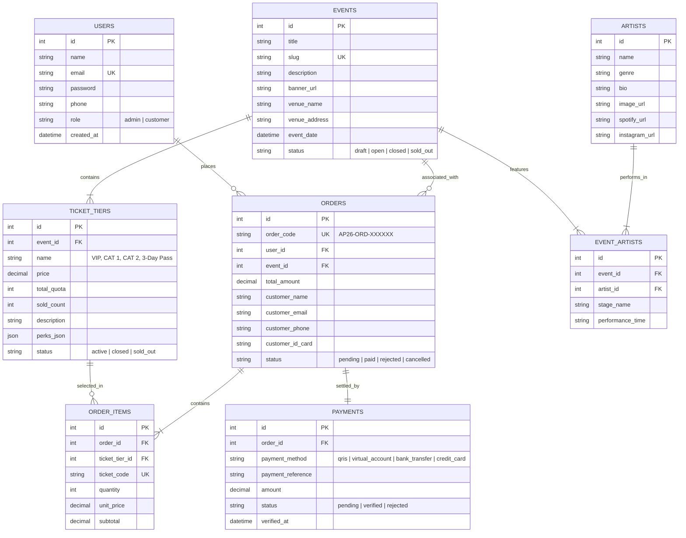

# 🎟️ AURORA PULSE: SISTEM MANAJEMEN & TIKET KONSER FULL-STACK

Aplikasi web sistem tiket konser dan festival musik modern lengkap dengan backend **Next.js (App Router)**, basis data **MySQL2**, REST API terstruktur, autentikasi **Bcrypt** & **JWT**, modul **Admin Web**, dan portal **Pelanggan Mobile-Friendly**.

---

## 📌 1. Kredensial Akun Bawaan (Default Seeder)

Password dienkripsi menggunakan algoritma **Bcrypt (10 salt rounds)** di database.

| Role | Email | Password Asli | Akses Halaman |
| :--- | :--- | :--- | :--- |
| **Administrator** | `admin@aurorapulse.com` | `AdminAurora2026!` | `/admin/login` & `/admin` |
| **Pelanggan Demo** | `customer@gmail.com` | `User12345!` | `/login` & `/orders` |

---

## 🗄️ 2. Entity Relationship Diagram (ERD) & Struktur Database

Skema SQL lengkap dengan tabel berelasi, relasi foreign key `ON DELETE CASCADE`, index pencarian, dan data seeder bawaan tersedia di berkas [`database/schema.sql`](database/schema.sql).



---

## 🚀 3. Fitur Utama

### a. Modul Admin Web (`/admin`)
- **Autentikasi & Login Admin**: Akses portal dengan verifikasi role dan token.
- **Dashboard Statistik**:
  - Total tiket terjual dan total omzet pendapatan (IDR).
  - Monitoring kuota per kelas tiket (VIP, CAT 1, CAT 2, 3-Day Pass).
  - Status pesanan terbaru & verifikasi cepat.
- **CRUD Event / Konser**: Tambah, edit, hapus konser, serta **tombol saklar Buka / Tutup Penjualan Tiket** secara instan.
- **CRUD Kategori Tiket**: Atur nama kelas, harga tiket, total kuota penonton, deskripsi, dan daftar fasilitas/perks.
- **CRUD Penyanyi / Artis**: Kelola nama penampil, genre, bio, foto panggung, dan tautan sosial media.
- **Daftar & Verifikasi Pesanan**:
  - Cari pesanan berdasarkan kode pesanan, nama pembeli, atau email.
  - Filter status (Pending, Lunas/Paid, Ditolak).
  - Aksi **Verifikasi Pembayaran (Approve / Reject)** yang langsung menerbitkan status tiket resmi.

### b. Modul Pelanggan Mobile-Friendly (`/`)
- **Register & Login Pelanggan**: Pendaftaran akun aman dengan validasi Zod dan enkripsi Bcrypt.
- **Katalog & Detail Konser**: Informasi jadwal konser, venue GBK Jakarta, dan lineup jadwal panggung.
- **Audio Synthesizer Sound Preview**: Pengunjung dapat mendengarkan cuplikan audio musik live via Web Audio API.
- **Peta Interaktif Venue GBK**: Peta vektor interaktif untuk melihat letak panggung, tribun, VIP moshpit, dan F&B.
- **Pemesanan & Checkout Tiket**: Form pemesanan tiket dengan kalkulasi total dan pilihan metode bayar (QRIS, VA BCA, Kartu Kredit).
- **Riwayat Pesanan & E-Ticket QR Code (`/orders`)**:
  - Tampilan daftar transaksi pelanggan.
  - **Dynamic QR Code Ticket Pass**: Menampilkan kartu E-Ticket resmi digital dengan QR Code unik dan barcode untuk validasi gerbang masuk.

---

## 📡 4. Dokumentasi REST API

| Method | Endpoint | Deskripsi | Akses |
| :--- | :--- | :--- | :--- |
| `POST` | `/api/auth/login` | Login user (admin / customer) | Publik |
| `POST` | `/api/auth/register` | Pendaftaran akun pelanggan | Publik |
| `GET` | `/api/auth/me` | Ambil profil user dari token JWT | Auth |
| `GET` | `/api/events` | Ambil seluruh daftar konser | Publik |
| `POST` | `/api/events` | Tambah event konser baru | Admin |
| `GET` | `/api/events/[id]` | Ambil detail konser & tiket | Publik |
| `PUT` | `/api/events/[id]` | Perbarui data konser | Admin |
| `DELETE`| `/api/events/[id]` | Hapus konser | Admin |
| `GET` | `/api/tickets` | Ambil daftar kategori tiket | Publik |
| `POST` | `/api/tickets` | Tambah kategori tiket baru | Admin |
| `PUT` | `/api/tickets/[id]` | Perbarui kuota / harga tiket | Admin |
| `DELETE`| `/api/tickets/[id]` | Hapus kategori tiket | Admin |
| `GET` | `/api/artists` | Ambil daftar penyanyi / artis | Publik |
| `POST` | `/api/artists` | Tambah artis baru | Admin |
| `PUT` | `/api/artists/[id]` | Perbarui profil artis | Admin |
| `DELETE`| `/api/artists/[id]` | Hapus artis | Admin |
| `GET` | `/api/orders` | Ambil daftar pesanan pelanggan | Publik / Auth |
| `POST` | `/api/orders` | Buat pesanan tiket baru | Publik / Auth |
| `GET` | `/api/orders/[id]` | Ambil detail pesanan & QR code | Publik / Auth |
| `GET` | `/api/admin/dashboard` | Ambil metrik & statistik admin | Admin |
| `GET` | `/api/admin/orders` | Ambil seluruh pesanan untuk admin | Admin |
| `POST` | `/api/admin/orders/[id]/verify` | Verifikasi status pembayaran | Admin |
| `POST` | `/api/admin/events/[id]/toggle-sales` | Buka / tutup penjualan tiket | Admin |

---

## 💻 5. Cara Menjalankan Aplikasi

### Langkah 1: Persiapan Database MySQL
Buka terminal MySQL / phpMyAdmin / Laragon dan impor berkas skema:
```bash
mysql -u root -p < database/schema.sql
```
Atau salin isi kueri dari berkas `database/schema.sql` dan jalankan di SQL query editor Anda.

### Langkah 2: Konfigurasi Environment
Pastikan berkas `.env.local` memiliki konfigurasi yang sesuai dengan MySQL Anda:
```env
DB_HOST=localhost
DB_PORT=3306
DB_USER=root
DB_PASSWORD=
DB_NAME=concert_tickets_db
JWT_SECRET=super_secret_aurora_pulse_jwt_key_2026
```

### Langkah 3: Jalankan Aplikasi
```bash
npm install
npm run dev
```
Buka browser di:
- **Website Pelanggan**: [http://localhost:3000/](http://localhost:3000/)
- **Riwayat Tiket & QR Code**: [http://localhost:3000/orders](http://localhost:3000/orders)
- **Portal Admin & Dashboard**: [http://localhost:3000/admin](http://localhost:3000/admin)

---

## 📤 6. Petunjuk Upload ke GitHub

Jalankan perintah berikut di terminal:
```bash
git init
git add .
git commit -m "feat: complete fullstack concert ticketing system with Next.js, MySQL2, and Admin Dashboard"
git branch -M main
git remote add origin https://github.com/<USERNAME_ANDA>/<NAMA_REPO_ANDA>.git
git push -u origin main
```
